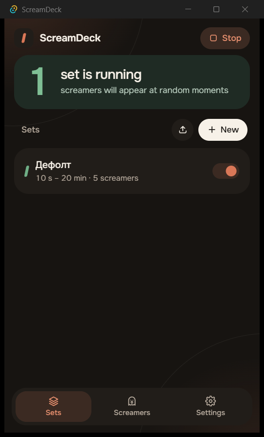
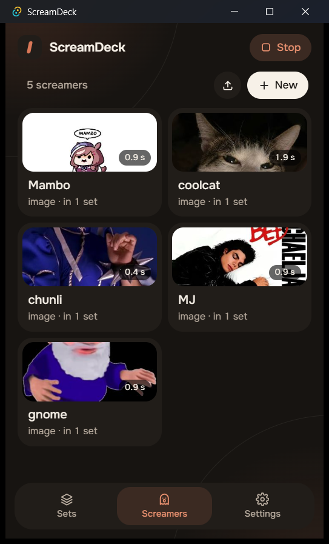
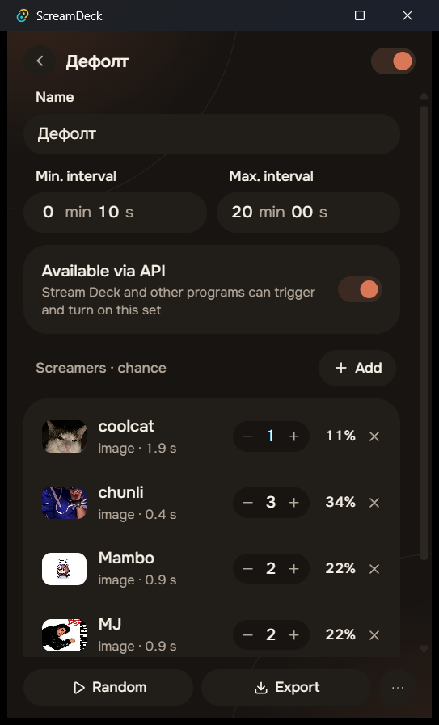
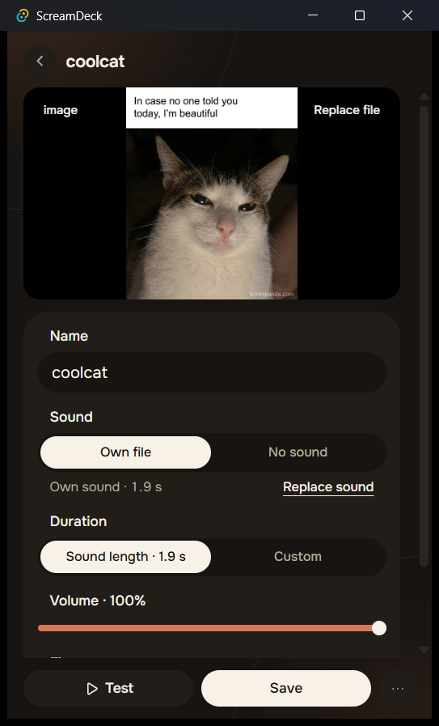
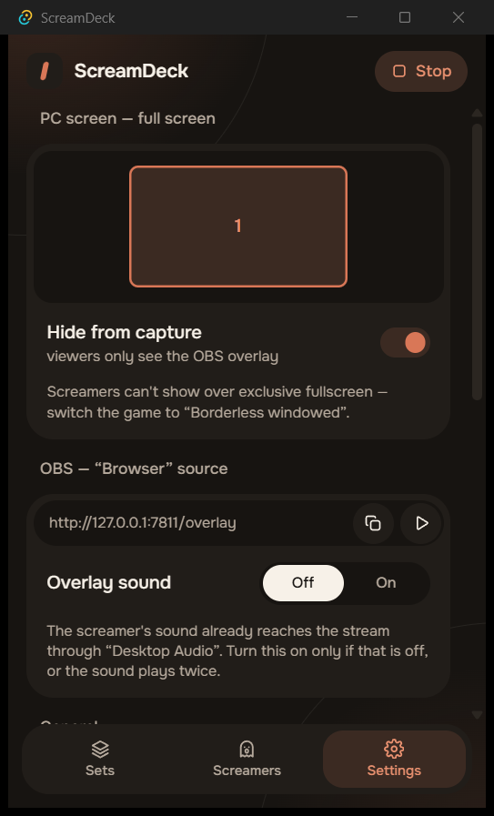

[English](README.md) | **Русский**

<h1 align="center">ScreamDeck</h1>

<p align="center">
  Скримеры для стрима.<br>
  Картинка, гифка или видео со звуком выскакивает поверх всего: тебе — на весь экран, зрителям — аккуратным оверлеем в OBS.
</p>

<p align="center">
  <a href="https://github.com/ikuriiruki/ScreamDeck/releases/latest"></a>
  
  <a href="LICENSE"></a>
</p>

<p align="center">
  
  
  
</p>

## Возможности

- **Скримеры** — картинка, гифка или видео; звук из видео, свой аудиофайл или без звука. Длительность по длине звука или своя; у каждого скримера своя громкость и вписывание в экран (заполнить / целиком).
- **Наборы** — минимальный и максимальный интервал и список скримеров с весами, чтобы редкие оставались редкими. Можно включить несколько наборов сразу, скримеры никогда не накладываются.
- **Тебе и зрителям — разное** — на весь экран на выбранных мониторах (скрыто от захвата экрана) и отдельный оверлей-источник «Браузер», размер и место которого задаются в OBS.
- **Локальное API** — вызвать скример или случайный из набора, стоп, включить/выключить набор. Уже для Stream Deck, потом для Твича.
- **Импорт и экспорт** — делитесь наборами в `.zip`; чужие архивы проверяются до того, как что-то запишется на диск.
- **Клавиша «Стоп»**, значок в трее, автозапуск, светлая и тёмная тема, интерфейс на русском и английском.

<p align="center">
  
  
</p>

## Быстрый старт

1. Скачайте `ScreamDeck_*-setup.exe` из [последнего релиза](https://github.com/ikuriiruki/ScreamDeck/releases/latest). Установщик пока не подписан: в окне SmartScreen нажмите **Подробнее → Выполнить в любом случае**.
2. Добавьте несколько скримеров, соберите из них набор и включите его.
3. В OBS добавьте источник **«Браузер»** со ссылкой `http://127.0.0.1:7811/overlay`. Игры запускайте в режиме **«оконный без рамки»**.

```bash
curl -X POST http://127.0.0.1:7811/api/trigger/set/<id-набора>
```

Полное руководство — настройка OBS, справочник API, разработка: **[документация](docs/README.ru.md)**.

## Лицензия

[MIT](LICENSE) © 2026 ikuriiruki
